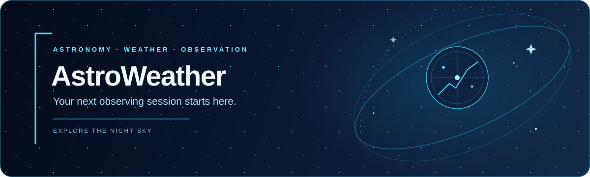

 <div align="center">


# AstroWeather 🌌

**A desktop astronomy and observing planner**

Explore the night sky. Plan your next observation.

Astronomical calculations, weather forecasts, telescope tools, and observing-session planning in one desktop application.

[](https://www.python.org/)
[](https://github.com/trinhtien48282-alt/AstroWeather)
[](https://open-meteo.com/)

</div>

---

## Contents

- [Overview](#overview)
- [Features](#features)
- [How It Works](#how-it-works)
- [Requirements](#requirements)
- [Installation](#installation)
- [Optional Astropy Support](#optional-astropy-support)
- [Configuration and Local Data](#configuration-and-local-data)
- [Building for Windows](#building-for-windows)
- [Troubleshooting](#troubleshooting)
- [Development](#development)
- [Limitations](#limitations)
- [Star History](#star-history)

## Overview

AstroWeather is an experimental Python desktop application for amateur astronomers. It brings astronomical calculations, weather forecasts, optical calculations, and observing-session planning into one interface.

Explore celestial objects, inspect forecast conditions, compare potential observing targets, and calculate how your telescope and eyepieces affect what you can observe.

Astronomical calculations run locally, while weather forecasts and location searches use online services.

## Features

| Feature | Description |
|---|---|
| 🌙 **Tonight & Forecast** | Inspect hourly forecasts, observing conditions, Moon interference, and potential observing windows. |
| 🔭 **Observing Planner** | Rank potential targets by visibility, altitude, equipment compatibility, and forecast conditions. |
| 🪐 **Sky Chart** | Explore the Sun, Moon, planets, stars, and deep-sky objects. |
| 📐 **Telescope Calculator** | Calculate magnification, field of view, resolution, camera sampling, and related optical values. |
| 🌌 **Astronomy Engine** | Calculate celestial positions using built-in algorithms, with optional NumPy acceleration and optional Astropy calculations. |
| 📍 **Location Settings** | Configure observing coordinates and local conditions. |
| 🛠️ **Equipment Configuration** | Configure your telescope, eyepieces, and Barlow lenses. |
| 🌦️ **Weather Integration** | Retrieve forecast data through Open-Meteo and cache weather data. |
| 🖥️ **Windows Packaging** | Package the application using PyInstaller's onedir distribution. |

## How It Works

AstroWeather combines five parts of the observing workflow:

1. **Location:** Set your observing coordinates and local conditions.
2. **Astronomy:** Calculate celestial positions for the sky chart and planner.
3. **Weather:** Retrieve forecast data from Open-Meteo to help estimate observing conditions.
4. **Equipment:** Use telescope and eyepiece specifications to calculate optical values.
5. **Planning:** Combine target information, equipment compatibility, and forecast conditions to prioritize observations.

Forecast estimates and target rankings have limitations. They are planning aids, not guarantees of what you will see through the telescope.

## Requirements

- Python 3.12 or newer
- PySide6
- NumPy
- Internet access for weather forecasts and location searches

The default dependencies are listed in [`requirements.txt`](requirements.txt). Astropy is optional and is not included in the standard dependency list.

## Installation

### Run from source

Clone the repository and install its dependencies:

```powershell
git clone https://github.com/trinhtien48282-alt/AstroWeather.git
cd AstroWeather

python -m venv .venv
.\.venv\Scripts\Activate.ps1

python -m pip install -r requirements.txt
python main.py
```

Run these commands from the repository directory and keep the terminal open while the application is running.

**If PowerShell blocks virtual-environment activation**, use the environment's Python executable directly:

```powershell
.\.venv\Scripts\python.exe -m pip install -r requirements.txt
.\.venv\Scripts\python.exe main.py
```

### Windows executable

When prebuilt releases are available, check the [GitHub Releases page](https://github.com/trinhtien48282-alt/AstroWeather/releases).

To build the application yourself, follow [`BUILDING.md`](BUILDING.md).

## Optional Astropy Support

Astropy can enable optional high-precision astronomical position calculations supported by the application.

Install it with:

```powershell
python -m pip install astropy
```

Astropy is not included in the default dependencies or standard Windows build. See [`BUILDING.md`](BUILDING.md) for instructions on including it in a packaged build.

## Configuration and Local Data

AstroWeather stores its configuration, weather cache, and diagnostic logs in a user-writable application data directory.

| Platform | Data directory |
|---|---|
| Windows | `%APPDATA%\AstroWeather\` |
| Other platforms | `~/.config/AstroWeather/` |

The application data directory can contain:

- `config.json`: saved application settings.
- `cache.json`: cached weather data.
- `error.log`: diagnostic information for unexpected GUI callback and worker errors.

Cached data may allow AstroWeather to display the last successful forecast if a refresh fails. Fresh forecasts and location searches require an internet connection.

## Building for Windows

AstroWeather includes a PyInstaller onedir specification.

From the repository root, run:

```powershell
uv run pyinstaller --noconfirm AstroWeather.spec
```

The distribution is created in:

```text
dist\AstroWeather\
```

Launch `AstroWeather.exe` from that directory.

> **Important:** Keep the supporting files and directories alongside the executable. The onedir distribution is not designed to work as a standalone EXE copied out of its folder.

For build prerequisites, configuration, diagnostic options, and first-run checks, see [`BUILDING.md`](BUILDING.md).

## Troubleshooting

<details>
<summary><strong>The application does not start</strong></summary>

Run the application from the repository root:

```powershell
python main.py
```

Check the traceback for missing dependencies or configuration errors. Confirm that Python 3.12 or newer is installed and that the project dependencies are available.

Unexpected GUI callback and worker errors may be recorded in `error.log` in the application data directory.

</details>

<details>
<summary><strong>Weather forecasts or location searches fail</strong></summary>

Check your internet connection. Weather and geocoding requests depend on Open-Meteo services, so network restrictions, service outages, or invalid responses may prevent updates.

When cached data is available, the application may continue displaying the last successful forecast.

</details>

<details>
<summary><strong>The observing planner is unavailable</strong></summary>

The planner requires NumPy. Reinstall the project dependencies and restart AstroWeather:

```powershell
python -m pip install -r requirements.txt
```

</details>

<details>
<summary><strong>The packaged Windows application fails to launch</strong></summary>

Build from the repository root and inspect the terminal output. Consult `BUILDING.md` for diagnostic build options.

Launch the executable from the complete `dist\AstroWeather\` directory rather than copying the EXE by itself.

</details>

## Development

The project is organized by responsibility:

| Directory or file | Purpose |
|---|---|
| `astro/` | Core celestial calculations |
| `astronomy/` | Observing and equipment calculations |
| `weather/` | Weather forecast data |
| `planner/` | Observing target planning |
| `gui/` | Desktop interface |
| `main.py` | Application entry point |
| `BUILDING.md` | Windows packaging instructions |

AstroWeather is under active development, so features, calculations, and the interface may evolve.

Bug reports, suggestions, and contributions are welcome through the [GitHub issue tracker](https://github.com/trinhtien48282-alt/AstroWeather/issues).

## Limitations

AstroWeather is an amateur astronomy planning tool, not a professional observatory system or a substitute for authoritative astronomical data.

- **Atmospheric estimates:** Forecast-based seeing and transparency values are estimates or proxies, not direct measurements.
- **Deep-sky visibility:** Visibility scores are approximate and depend on assumptions about observing conditions and equipment.
- **Weather uncertainty:** A forecast cannot guarantee that a target will be observable.
- **Calculation precision:** Results depend on the selected astronomy engine, its configuration, and the calculation being performed.

Use the results as planning aids and evaluate actual conditions at your observing site.

<p align="center">
  
</p>

## Star History

[](https://star-history.com/#trinhtien48282-alt/AstroWeather&Date)

---

<div align="center">

*Clear skies. Dark nights. Better observations.* 🌌

</div>
